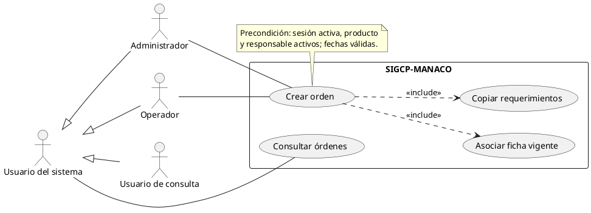

# Prompt experto: informe integral de casos de uso UML de SIGCP–MANACO

## Cómo utilizar este archivo

Copia todo el contenido desde **«INICIO DEL PROMPT»** hasta **«FIN DEL PROMPT»** y entrégalo a la IA que redactará el informe. El contexto necesario está incorporado: puede trabajar sin acceder al repositorio. Si tiene acceso al código, debe contrastar los detalles con las fuentes indicadas y señalar cualquier diferencia comprobada.

Este archivo es un **prompt para producir el informe**, no el informe terminado. El resultado solicitado debe incluir los diagramas de casos de uso, sus gráficos UML y sus explicaciones, no limitarse a proponer cómo elaborarlos.

---

# INICIO DEL PROMPT

## 1. Rol profesional y misión

Actúa como un equipo experto en ingeniería de requisitos, análisis de sistemas, UML 2.x y redacción de informes académicos de ingeniería de software. Escribe en español formal, preciso y comprensible.

Elabora un **informe completo de TODOS los casos de uso del sistema SIGCP–MANACO**, organizados mediante una descomposición progresiva desde el **nivel 0** hasta el **último nivel N necesario**. Cada diagrama, en cualquier nivel, debe tener:

1. Identificador y título únicos.
2. Nivel de abstracción y referencia explícita a su diagrama o agrupación padre.
3. **Gráfico UML correspondiente**, con actores, óvalos de casos de uso, límite del sistema y las relaciones que realmente procedan.
4. **Código PlantUML completo y ejecutable** que reproduzca exactamente ese gráfico.
5. Un párrafo breve, de aproximadamente 70–120 palabras, que explique su objetivo, actores, funcionamiento y resultado.
6. Una tabla breve de los casos de uso representados y de sus restricciones relevantes.

No entregues únicamente texto, únicamente código UML ni un único diagrama general. Desarrolla el inventario completo, los niveles sucesivos y las hojas funcionales justificadas. No sustituyas los casos de uso por diagramas de actividades, flujogramas, diagramas entidad–relación o diagramas de clases.

## 2. Precisión metodológica sobre los niveles

Los números **0, 1, 2…N** son una **convención de organización y abstracción de este informe**. UML no establece una jerarquía universal obligatoria de niveles numerados para diagramas de casos de uso. Explica esta distinción brevemente al comienzo.

Aplica esta convención:

| Nivel | Finalidad |
|---|---|
| 0 | Visión global de la misión del sistema, sus límites y actores externos, con muy pocos objetivos globales. |
| 1 | Panorama de objetivos y áreas funcionales principales. Distribuye en varias láminas si la vista completa deja de ser legible. |
| 2 | Un diagrama por módulo o familia funcional, mostrando los objetivos concretos de cada actor. |
| 3 | Descomposición de los casos complejos o comportamientos compartidos cuando ello aporte precisión real. |
| 4…N | Solo si aún existe un comportamiento relevante que requiera una vista independiente; detenerse cuando las hojas expresen objetivos o servicios funcionales comprensibles y verificables. |

Reglas de descomposición:

- Las ramas pueden terminar en niveles diferentes. Determina el máximo nivel N efectivamente utilizado y justifícalo al final.
- No fuerces todos los casos a llegar a la misma profundidad.
- Un nivel más profundo **no** significa convertir cada campo, clic, consulta SQL o condición `if` en un caso de uso.
- Un objetivo sencillo puede terminar en el nivel 2. Uno complejo puede requerir nivel 3 o superior.
- El vínculo padre–hijo entre documentos se expresa en el árbol de trazabilidad y en la ficha del diagrama; **no implica automáticamente `<<include>>` ni `<<extend>>`**.
- Un área como «Gestionar fabricación» no incluye necesariamente todas las tareas cada vez que se ejecuta. Si solo agrupa objetivos, represéntala como paquete o agrupación, no como una cadena ficticia de inclusiones obligatorias.
- No dividas el informe como un diagrama de flujo de datos: aquí se modelan objetivos e interacciones externas, no transformaciones de datos por niveles.

## 3. Contexto y versión real del proyecto

### 3.1 Identidad y propósito

**Nombre:** SIGCP–MANACO.  
**Dominio:** gestión y control de fabricación de calzado.  
**Contexto funcional:** planta de producción de calzado, con referencias de interfaz a Cochabamba, Bolivia.  
**Finalidad:** centralizar productos, fichas de fabricación, órdenes, ejecución de etapas, materiales, inventario, reservas, trabajadores, incidencias, presupuestos, costos directos y evidencias de calidad.

El sistema es una aplicación de gestión interna. No es una tienda virtual ni un sistema de ventas al consumidor.

### 3.2 Arquitectura vigente

- Interfaz web en HTML, CSS y JavaScript, adaptable a móvil, tableta y escritorio.
- Backend Node.js con Express y validaciones de servidor.
- MySQL 8.4/InnoDB como fuente de verdad.
- API HTTP autenticada, con sesiones y perfiles.
- Transacciones y bloqueos para evitar stock negativo, reservas excesivas y consumos duplicados.
- Herramientas CLI para inicialización, actualización de esquema, respaldos, restauración alternativa y migración de datos.

**Importante:** el prototipo anterior guardaba un JSON en `localStorage`. La versión actual **sí tiene MySQL y backend real**. El almacenamiento anterior solo se consulta para exportar datos heredados; no es la persistencia operativa vigente.

MySQL, la API, la interfaz, el navegador utilizado como medio de interacción y las tablas son componentes o medios técnicos, **no actores externos del caso de uso del sistema completo**. No confundas un diagrama de arquitectura con uno de casos de uso.

### 3.3 Referencia de implementación

La implementación analizada está en la rama `feat/mysql-production-model` de `ATPtorres/SigcpManaco`, con referencia funcional del commit `2fbd9e0`.

Si puedes acceder al repositorio, usa esta prioridad de fuentes:

1. `server/users.cjs`: permisos y mantenimiento de cuentas.
2. `server/app.cjs`: operaciones API y autorización aplicada.
3. `server/service.cjs`: reglas de fabricación, inventario, trabajadores e incidencias.
4. `server/validation.cjs`: validaciones de entrada.
5. `server/legacy.cjs`: migración del prototipo.
6. `server/backup.cjs`: respaldo y restauración de negocio.
7. `app.js`: acciones disponibles en la interfaz, reportes, impresión y guía.
8. `scripts/*.cjs`: operaciones técnicas por consola.
9. `database/001_schema.sql`, `002_legacy.sql`, `003_roles.sql`: integridad y estructura.
10. `README.md`, `docs/modelo-mysql.md`, `docs/migracion-v1.md`, `docs/validacion-mysql.md`.
11. `tests/api.test.cjs` y `tests/interface.test.cjs`: evidencia de escenarios comprobados.

`docs/analisis-informe.md` describe decisiones históricas del prototipo; sus límites antiguos no deben atribuirse automáticamente a la versión MySQL actual.

Si no tienes acceso al código, utiliza el contexto incorporado a este prompt y declara esa limitación de verificación. No finjas haber inspeccionado archivos, ejecutado pruebas o renderizado imágenes.

## 4. Actores, perfiles y límites

### 4.1 Actores primarios reales de la aplicación

| Actor | Objetivos y permisos |
|---|---|
| Administrador | Puede consultar y ejecutar todas las funciones web, mantener catálogos y maestros, versionar fichas, operar fabricación, administrar cuentas, registrar presupuestos y evidencias del piloto, exportar respaldos de negocio e importar datos heredados. |
| Operador | Puede consultar información y reportes; crear órdenes; ejecutar etapas; registrar movimientos; reservar y liberar materiales; registrar y gestionar incidencias; registrar horas. No puede modificar catálogos, productos, maestros de materiales, trabajadores, tarifas, usuarios, presupuestos ni criterios del piloto. No puede importar respaldos heredados ni descargar el respaldo global de negocio. |
| Usuario de consulta | Puede iniciar/cerrar sesión, consultar información permitida, buscar, filtrar, visualizar reportes, exportar reportes CSV y solicitar impresión. No puede escribir datos. No administra usuarios, importa datos ni descarga el respaldo global de negocio. |

Si usas generalización, puedes introducir un actor base abstracto **«Usuario del sistema»** para capacidades comunes a los tres perfiles. No establezcas herencias entre perfiles que concedan permisos incorrectos. En particular, no hagas que Operador herede capacidades exclusivas del Administrador.

«Usuario del sistema» representa un rol externo genérico; «tener sesión activa» es una precondición de las funciones protegidas, no una identidad humana diferente. Iniciar sesión debe seguir teniendo sentido antes de que exista una sesión activa.

### 4.2 Actor técnico de soporte

Para los casos CLI, identifica **Administrador técnico / responsable de mantenimiento**, que ejecuta inicialización, migraciones de esquema, cambio de contraseña por consola, respaldos y restauraciones en otra base. Mantén este contexto claramente separado del perfil Administrador de la aplicación web.

No presupongas que poseer una cuenta administradora web concede credenciales del servidor o permisos de DBA. Puede ser la misma persona en una instalación, pero son responsabilidades y canales diferentes.

### 4.3 Personas y entidades que no deben inventarse como actores

- Un **trabajador zapatero** es un registro de personal; no es automáticamente un usuario que ingresa al software. Si un trabajador también usa el sistema, actúa con uno de los perfiles reales.
- Responsable de orden y responsable de incidencia son asignaciones a trabajadores, no perfiles de seguridad nuevos.
- Jefe de producción, encargado de almacén o inspector de calidad pueden describirse como responsabilidades organizativas atendidas por Administrador/Operador. No los presentes como roles implementados adicionales.
- No añadas cliente, proveedor, contador, pasarela de pagos, servicio de correo, maquinaria, sistema ERP o aplicación bancaria como actores implementados: no existe esa integración.
- Un archivo JSON, una tabla, la base MySQL o el algoritmo de cálculo no son actores humanos.
- No inventes recuperación de contraseña por correo: existe restablecimiento administrativo y cambio técnico por consola.

## 5. Inventario funcional obligatorio para el informe

Utiliza este inventario como lista de cobertura. Puedes agrupar o refinar los nombres, pero debes demostrar dónde queda representada **cada función aplicable**. «Consultar» y «mantener» no deben ocultar que algunas entidades solo permiten alta y consulta, mientras otras también permiten edición o inactivación.

### F01. Acceso y sesión

- Iniciar sesión con usuario y contraseña.
- Consultar la sesión vigente.
- Cerrar sesión.
- Tratar credenciales incorrectas, cuenta inactiva y sesión expirada como alternativas/excepciones.
- Revocar sesiones cuando un administrador modifica acceso, nombre de usuario, contraseña o perfil.
- Tras diez intentos de acceso acumulados sin éxito dentro de la ventana aplicada, bloquear temporalmente nuevos intentos durante la ventana de quince minutos correspondiente. No representar el control de intentos como un objetivo independiente del usuario.
- La sesión caduca a las ocho horas; contraseñas con hash scrypt y cookies HttpOnly/SameSite son requisitos de seguridad, no objetivos separados del usuario final.

### F02. Usuarios y permisos

Actor exclusivo: Administrador.

- Consultar cuentas.
- Crear usuario con contraseña inicial.
- Editar nombre, perfil y estado.
- Activar o desactivar cuenta.
- Restablecer contraseña administrativa.
- Conservar al menos un administrador activo.
- Revocar sesiones anteriores cuando corresponda.

No existe eliminación de usuarios ni autorregistro público. La activación, inactivación y asignación de perfil son comportamientos del mantenimiento de cuentas; no simules endpoints independientes si se realizan mediante la misma edición.

### F03. Catálogos básicos

Administrador da de alta; los perfiles autorizados pueden consultar los datos que usa la aplicación.

- Unidades de medida: nombre y símbolo únicos.
- Líneas de calzado.
- Tallas: sistema y valor, con combinación única.
- Colores y tono de presentación.
- Modelos: código, nombre, línea y descripción.
- Etapas de fabricación.
- Ubicaciones de inventario.

**Límite real:** los endpoints actuales de estos catálogos ofrecen alta y consulta; no atribuyas edición ni borrado general de catálogos que no estén implementados.

### F04. Materiales

Administrador mantiene el maestro; Operador y Administrador registran movimientos por el módulo de inventario.

- Consultar, buscar y filtrar materiales.
- Dar de alta material con código, unidad, costo de referencia, mínimo y observación.
- Registrar saldo inicial por lote y ubicación cuando se indique una cantidad inicial.
- Editar maestro de material.
- Activar o inactivar material.
- Confirmar el costo de referencia de un material heredado al mantenerlo explícitamente.
- Consultar alertas por mínimo y disponibilidad.

No permitir cambio de unidad si el material ya tiene recetas o lotes. No modificar el saldo mediante la edición del maestro: debe existir un movimiento.

### F05. Lotes, ubicaciones, movimientos y reservas

- Consultar existencias por material, lote y ubicación.
- Registrar entrada, con lote, ubicación, cantidad, costo y motivo.
- Registrar salida general, con cantidad y motivo.
- Consultar historial de movimientos.
- Consultar saldo, reservado y disponible.
- Reservar material para una etapa pendiente de una orden abierta.
- Consultar reservas activas.
- Liberar reserva.
- Consumir material de una etapa cuando esta se inicia; es comportamiento de ejecución, no una opción de consumo manual duplicada.

Reglas:

- Saldo = entradas − salidas − consumos.
- Disponible = saldo − reservas activas.
- La reserva debe corresponder a un material requerido por la etapa.
- No reservar más que el requerimiento ni más que la disponibilidad.
- Las salidas no pueden gastar material reservado para otras operaciones.
- El consumo prioriza lotes reservados por esa etapa y después las recepciones más antiguas.
- No existen transferencias explícitas entre ubicaciones, compras integrales ni gestión de proveedores.

### F06. Productos, variantes y fichas

- Consultar y buscar productos por SKU, modelo, talla y color.
- Crear una variante SKU para una combinación modelo–talla–color única.
- Definir una ficha con etapas, secuencias, tiempos, costo estimado de mano de obra por par, materiales y merma.
- Agrupar materiales de una misma etapa/secuencia.
- Editar producto y generar una nueva versión de ficha.
- Consultar fichas vigentes y archivadas.
- Activar o inactivar variante.

Reglas:

- Al menos una etapa y al menos un material en el conjunto de la ficha.
- Secuencias únicas; un material no se repite dentro de una misma etapa.
- La ficha anterior se archiva y sus detalles históricos no se sobrescriben.
- Una orden existente conserva la ficha elegida y sus requerimientos.
- Si ya existen órdenes del producto, no cambiar su SKU, modelo, talla ni color: se necesita otra variante.
- No existen eliminación física del producto ni cambios retroactivos de receta de una orden ya creada.

### F07. Planificación y consulta de órdenes

- Crear orden de fabricación.
- Seleccionar variante activa, responsable activo, cantidad, fechas programadas y prioridad.
- Asociar ficha vigente.
- Crear el detalle de etapas de la orden y copiar requerimientos desde la ficha.
- Consultar listado, detalle, historial y tablero de seguimiento.
- Buscar, filtrar y actualizar la información visible desde el servidor.

Restricciones:

- Cantidad entera positiva.
- Entrega programada no anterior al inicio.
- La etapa debe pertenecer a la ficha de esa orden.
- No existe edición general posterior de la orden, cancelación, eliminación ni retroceso de estados en el alcance implementado.

### F08. Ejecución por etapas

- Iniciar producción de la orden; inicia su primera etapa.
- Iniciar una etapa posterior cuando corresponda.
- Consultar necesidades de materiales y estado de las etapas.
- Validar disponibilidad y consumir requerimientos de esa etapa una sola vez.
- Aplicar merma y registrar consumos por existencia y etapa.
- Terminar etapa registrando pares aceptados y rechazados.
- Consultar tiempos reales disponibles e historial.

Reglas críticas:

- Orden general: Pendiente → En producción → Control de calidad → Terminado → Despachado.
- Estados de etapa: Pendiente → En producción → Terminado.
- Para iniciar una etapa posterior, las anteriores deben estar terminadas.
- Requerimiento = cantidad neta por par × (1 + merma/100) × cantidad planificada; redondeo a cuatro decimales.
- Si falta cualquier material, se revierte todo el consumo de esa operación.
- Dos solicitudes simultáneas no pueden consumir dos veces la orden/etapa ni gastar el mismo saldo.
- Para terminar una etapa, aceptados + rechazados deben sumar el plan de la orden y sus incidencias deben estar resueltas.
- El rechazo se registra; no genera automáticamente reprocesos, compras ni órdenes nuevas.

### F09. Calidad, terminación y despacho

- Enviar orden a control de calidad cuando todas sus etapas estén terminadas.
- Registrar evidencia de aprobación.
- Para una orden heredada en calidad sin conteo confirmado, capturar los pares aceptados y rechazados observados; deben sumar el plan.
- Terminar orden cuando cumpla las condiciones.
- Registrar despacho como último estado.

No cerrar si existen incidencias sin resolver. La evidencia de calidad es obligatoria. No inventar archivos adjuntos, firma digital, aprobación por comité ni perfiles de inspector no implementados. El despacho no constituye una venta, facturación ni gestión de transporte, y no implica un inventario de producto terminado que no esté implementado.

### F10. Incidencias de producción

- Registrar incidencia vinculada a una etapa de una orden abierta.
- Indicar tipo, descripción, severidad, responsable e impacto económico estimado opcional.
- Consultar, buscar y filtrar incidencias.
- Gestionar estado: Abierta, En atención, Resuelta.
- Registrar acción/resolución documentada y cierre.

No resolver sin acción documentada. No trasladar una incidencia existente a otra etapa. Las órdenes terminadas/despachadas no admiten esta modificación operativa. Una incidencia puede aparecer durante una etapa; **no se produce obligatoriamente cada vez que se inicia o termina**.

### F11. Trabajadores, habilidades y mano de obra

Administrador mantiene trabajadores; Administrador y Operador registran horas.

- Consultar personal.
- Crear y editar trabajador con código, nombre, contratación, tarifa y estado.
- Activar/inactivar trabajador.
- Asignar etapas habilitadas.
- Confirmar tarifa pendiente de un trabajador heredado.
- Registrar horas de un trabajador en una etapa en producción.
- Consultar horas, tarifa aplicada y costo calculado.

Condiciones:

- Trabajador activo y habilitado para la etapa.
- Tarifa confirmada antes de registrar horas de un trabajador heredado.
- Horas positivas y máximo acumulado de 24 horas por trabajador y fecha.
- Conservar la tarifa aplicada al registrar; cambios posteriores de tarifa no revalúan registros anteriores.
- No existe nómina, pago de salarios ni control completo de asistencia.

### F12. Presupuestos y costos

Administrador registra presupuestos; los perfiles con acceso de lectura consultan la información disponible.

- Crear presupuesto para una orden.
- Generar una nueva versión.
- Registrar partidas: concepto, tipo de costo, unidad, cantidad y costo estimado.
- Establecer emisión, vigencia, contingencia y estado de aprobación al registrar la versión.
- Consultar versiones y detalle de partidas.
- Calcular subtotal y total con contingencia.
- Consultar costos directos registrados de materiales y mano de obra por orden.
- Distinguir importes completos, parciales y desconocidos del legado.

No inventar un procedimiento independiente de aprobación multinivel: el estado Borrador/Aprobado/Rechazado se registra en la creación de la versión. No existe un endpoint separado para aprobar una versión previamente guardada. No presentar el presupuesto académico fijo del proyecto como si fuera un presupuesto operativo por orden. No afirmar contabilidad industrial completa ni costos indirectos que no se registraron.

### F13. Panel, alertas, consultas y reportes

- Consultar indicadores del panel, plan cerrado y pares conformes medidos.
- Consultar producción por modelo, órdenes recientes y alertas.
- Abrir el centro de atención con alertas por inventario e incidencias.
- Consultar seguimiento y distribución por estado.
- Buscar y filtrar listados.
- Filtrar reportes por fecha de creación de la orden.
- Exportar reportes de órdenes/materiales en CSV.
- Solicitar impresión / PDF mediante el diálogo de impresión del navegador.
- Consultar guía de uso.
- Actualizar los datos visibles para leer cambios de otras sesiones.

El filtro temporal de reportes es por creación de la orden, no por cualquier fecha productiva. El inventario mostrado es el saldo actual. No afirmar que existen correos, SMS, notificaciones push, sincronización en tiempo real o generación PDF en el servidor. El sistema solicita impresión; guardar PDF depende del navegador/usuario. No considerar los controles de búsqueda simples como descomposiciones infinitas: pueden describirse dentro de un caso de consulta cuando convenga.

### F14. Historial, auditoría y piloto

- Consultar historial de una orden.
- Consultar la bitácora de acciones del servidor con usuario y fecha.
- Consultar criterios de preparación del piloto.
- Administrador registra evidencia y marca cada criterio como pendiente/validado.

Los diez criterios se refieren a alcance, responsables, depuración de datos, órdenes de prueba, casos de prueba, defectos críticos, accesos y respaldos, capacitación, indicadores y continuidad. Son una lista de evidencias; marcar «Validado» no es una aprobación externa real de un comité. La auditoría no se afirma inmutable frente a un administrador de MySQL.

### F15. Datos heredados, exportación y restauración

Separa las funciones web de las funciones técnicas CLI.

**Web, Administrador:**

- Exportar un respaldo JSON de las 29 tablas de negocio.
- Exportar datos anteriores de `localStorage` si están en el mismo origen del navegador.
- Seleccionar un respaldo JSON v1.
- Revisar vista previa con cantidades, advertencias, conflictos y hash.
- Confirmar importación aditiva.
- Consultar importaciones realizadas y su procedencia.
- Tratar archivo inválido, relaciones rotas, cambio del archivo, conflicto de códigos y archivo ya importado como escenarios alternativos o de excepción.

**CLI, Administrador técnico:**

- Crear respaldo de negocio en archivo nuevo.
- Restaurar en una base alternativa, diferente de la activa y vacía de datos de negocio.
- Aplicar esquema en el destino y validar referencias/saldos dentro de la restauración.
- Ejecutar migración del JSON original o de un archivo explícito.
- Si se documenta respaldo SQL completo con herramientas MySQL, identificarlo como procedimiento técnico, no como botón o API de la aplicación.

Reglas:

- No borrar ni reemplazar registros de la base activa al importar.
- Conservar hash, documento original, mapa de IDs, fecha y actor.
- El mismo archivo no se aplica dos veces, tampoco con solicitudes concurrentes.
- Un conflicto tardío revierte todas las inserciones.
- La exportación de negocio excluye contraseñas y sesiones.
- La restauración web completa **no existe**: la restauración se ejecuta por CLI en otra base.
- El origen anterior del navegador puede ser otro host/puerto: no existe acceso automático a datos privados de otro origen.

### F16. Administración técnica de soporte

Mantén una vista o paquete de soporte separado, con Administrador técnico:

- Instalar dependencias y preparar la configuración local sin divulgar secretos.
- Aplicar actualizaciones versionadas del esquema.
- Inicializar catálogos y usuario administrador si no existe.
- Restablecer contraseña por consola y revocar sesiones.
- Consultar salud del backend/MySQL.
- Crear explícitamente datos ficticios de demostración o un circuito de ejemplo, solo como soporte de desarrollo/pruebas.
- Respaldar, restaurar y migrar según F15.

No expandas este paquete hasta convertir todo el despliegue de infraestructura en casos de uso de negocio. No supongas publicación automática del entorno cloud, HTTPS de producción ya instalado ni aceptación industrial real.

## 6. Modelo de datos como contexto, no como diagrama de casos de uso

El preliminar tenía 24 entidades y se implementaron conservando su propósito:

- UNIDAD_MEDIDA, LINEA_CALZADO, TALLA, COLOR.
- MATERIAL, MODELO_CALZADO, PRODUCTO_CALZADO.
- FICHA_FABRICACION, FICHA_ETAPA, ETAPA_FABRICACION.
- ORDEN_FABRICACION, DETALLE_ORDEN_ETAPA, REQUERIMIENTO_MATERIAL.
- LOTE_MATERIAL, UBICACION, EXISTENCIA_MATERIAL, RESERVA_MATERIAL, MOVIMIENTO_MATERIAL.
- TRABAJADOR_ZAPATERO, TRABAJADOR_ETAPA, REGISTRO_MANO_OBRA.
- INCIDENCIA_PRODUCCION, PRESUPUESTO, DETALLE_PRESUPUESTO.

Se añadieron RECETA_MATERIAL, USUARIO, SESION, HISTORIAL_ORDEN, AUDITORIA y CRITERIO_PILOTO; después IMPORTACION_LEGACY, BLOQUEO_MIGRACION y el control técnico SCHEMA_MIGRATION. Son 33 tablas incluyendo las auxiliares y el control de versiones.

Usa estas entidades para verificar términos y relaciones del dominio, **no para crear automáticamente un óvalo por tabla**. Una tabla no equivale a un caso de uso. Una acción CRUD tampoco necesita un diagrama independiente si una vista coherente del módulo la expresa bien.

## 7. Datos de demostración y estado de validación

Los ejemplos originales del repositorio son ficticios:

- Seis materiales, cuatro modelos y 26 variantes al separar tallas.
- Ocho órdenes OP-1041 a OP-1048, 1650 pares planificados en total.
- Dos incidencias y cuatro responsables.
- Saldo original conservado: MAT-001 = 420; MAT-002 = 1800; MAT-003 = 18; MAT-004 = 320; MAT-005 = 285; MAT-006 = 510.
- El archivo reproducible del legado fija una fecha base 2026-10-20 porque el prototipo generaba fechas relativas. No es una copia privada de otro navegador.
- Los antecedentes ausentes se identifican: no se inventan costos, tarifas, contratos, horas ni conteos históricos.
- La etapa global «Producción heredada» mantiene el estado sin volver a consumir materiales ya descontados; no afirma que se hayan registrado etapas físicas individuales.
- Un circuito ficticio nuevo muestra producción completa, mano de obra, incidencia resuelta, calidad, presupuesto y otra orden con reserva pendiente, separado del legado.

Como referencia documentada de implementación, pasaron 22 pruebas API/MySQL y 135 combinaciones de pantalla (15 vistas × nueve anchos), con auditoría automática en 30 vistas. Esto es evidencia de la versión revisada, **no prueba automática de que un informe UML sea correcto**, ni certificación completa WCAG ni aceptación con usuarios reales. No afirmes haber repetido estas pruebas si no las ejecutaste.

## 8. Reglas UML obligatorias

### 8.1 Asociaciones y límite

- Actores fuera del rectángulo del sistema; casos de uso dentro.
- Asociación actor–caso con línea continua, normalmente sin punta de flecha.
- Un actor puede participar en varios objetivos; una asociación no representa orden temporal ni flujo de datos.
- Mantén un límite consistente: solución web completa en las vistas funcionales; herramientas de mantenimiento en una vista de soporte identificada.
- Nombres de casos con verbo en infinitivo + objeto: «Registrar incidencia», «Reservar material», «Consultar ficha».

### 8.2 `<<include>>`

- Flecha discontinua **del caso que incluye hacia el caso incluido**.
- Úsala para comportamiento obligatorio incorporado al caso base cuando se ejecuta en las condiciones descritas.
- Ejemplo posible y delimitado: «Crear orden» incluye «Asociar ficha vigente» y «Copiar requerimientos». Explica el alcance, sin convertir cada inserción SQL en otro caso.
- «Iniciar etapa» puede incluir «Consumir materiales requeridos» si expresas que una etapa puede no requerir materiales y que el comportamiento resuelve esa condición; de lo contrario describe la condición en la especificación y evita una inclusión ambigua.
- Autenticación es normalmente una **precondición** de las funciones protegidas. No dibujes `<<include>> Iniciar sesión` desde todos los casos como si se repitiera el login en cada operación.

### 8.3 `<<extend>>`

- Flecha discontinua **del caso que extiende hacia el caso base**.
- Úsala solo para una ampliación opcional/condicional de un caso base que tiene sentido completo por sí mismo, indicando condición y punto de extensión.
- No conviertas stock insuficiente, JSON inválido o credenciales incorrectas automáticamente en casos `extend`: normalmente son escenarios alternativos o excepciones.
- No fuerces «Registrar incidencia» como extensión de «Terminar etapa» si no puedes justificar un punto real de extensión: la incidencia es una interacción independiente durante la operación.
- La «Confirmación de importación» ocurre tras una vista previa revisada. Modela la relación con rigor; no uses una flecha de asociación para fingir secuencia temporal.

### 8.4 Generalización

- Línea continua con triángulo hueco **desde el actor/caso especializado hacia el general**.
- La especialización debe cumplir la semántica de herencia de participación/comportamiento.
- Un perfil de seguridad más poderoso no es automáticamente una subclase de otro perfil si ello confunde permisos; un actor común abstracto es suficiente.
- No utilices generalización para expresar «primero ocurre A y después B».

### 8.5 Legibilidad

- No más de aproximadamente 8–12 casos por lámina cuando ello comprometa claridad; divide por objetivos, sin omitir cobertura.
- Evita cruces innecesarios y nombres excesivamente largos en óvalos.
- Usa identificadores internos ASCII y etiquetas visibles en español.
- Los casos reutilizados conservan el mismo ID funcional en todas las láminas; repetir una vista no crea otra función.
- Incluye leyenda cuando haya estereotipos o convenciones propias.

## 9. Plan de organización y trazabilidad

Antes de dibujar, construye:

1. Catálogo de actores y matriz actor–función.
2. Catálogo de casos de uso con IDs estables: por ejemplo `CU-ACC-01`, `CU-INV-01`, `CU-ORD-01`.
3. Árbol de diagramas `D0`, `D1-01`, `D2-INV`, `D3-INV-RES`, etc.
4. Referencia padre, nivel, alcance y criterio de terminación de cada rama.

Como guía, el nivel 2 debe cubrir F01–F16 mediante vistas coherentes. Puedes combinar F08/F09 o separar sus gráficos si ello mejora la lectura. Asegura descomposición adicional razonada de los procesos complejos:

- Definición y versionado de ficha.
- Creación de orden y congelación de requerimientos.
- Inicio de etapa, disponibilidad, reserva y consumo.
- Terminación, calidad y despacho, incluida calidad de datos heredados.
- Importación de respaldo: revisar, confirmar y conservar procedencia.
- Administración de acceso y revocación de sesiones.
- Respaldo/restauración técnica y sus límites frente al canal web.

Esta lista orienta la cobertura; no obliga a repetir diagramas que no añadan información. La profundidad se justifica por complejidad funcional, no por alcanzar un número arbitrario.

Incluye al final una matriz con columnas:

`Familia Fxx | CU | Nombre | Actor | Canal web/CLI | Nivel hoja | Diagrama(s) | Regla relevante | Fuente/evidencia`.

No dejes funciones del inventario sin una ubicación. Si una función no merece un caso independiente, indica explícitamente en qué especificación o caso queda cubierta y por qué.

## 10. Gráficos y archivos exigidos

**Notación principal: PlantUML.** No uses Mermaid como sustituto del gráfico de casos de uso: no aporta aquí una notación nativa equivalente completa.

Para cada diagrama:

- Entrega un bloque completo `plantuml`, desde `@startuml` hasta `@enduml`.
- Incluye todas las definiciones de actores, casos y relaciones necesarias para renderizarlo por separado.
- Usa `rectangle "SIGCP–MANACO"` o el límite técnico correctamente identificado.
- Usa `actor`, `usecase`, paquetes y notas cuando corresponda.
- No insertes marcadores de citas rotos, fragmentos `[span_...]`, pseudocódigo ni puntos suspensivos como sustitución de casos reales.
- Mantén equivalencia entre gráfico, código, nombres y tablas.

**Si dispones de herramientas de renderizado:** genera cada archivo `.puml`, su gráfico `.svg` (y `.png` si hace falta), verifica que renderiza y referencia la imagen real en el informe. Comprueba texto legible, actores completos y flechas sin recortes. No dependas de un servidor público para renderizar información del proyecto sin autorización.

**Si solo puedes producir texto:** entrega todos los bloques PlantUML autocontenidos y explica una sola vez que el código debe renderizarse para obtener las imágenes. No inventes enlaces a imágenes inexistentes ni afirmes que ya se generó un gráfico. Esta alternativa debe quedar identificada como limitación de entrega; no la presentes como un informe con imágenes ya renderizadas.

Estructura de entrega preferida cuando puedes crear archivos:

```text
informe-casos-de-uso/
  informe-casos-de-uso.md
  indice-diagramas.md
  catalogo-casos-de-uso.md
  uml/
    D0-contexto.puml
    D1-01-objetivos.puml
    D2-ACC-acceso.puml
    ... archivos reales para cada diagrama del índice ...
  graficos/
    D0-contexto.svg
    D1-01-objetivos.svg
    D2-ACC-acceso.svg
    ... imágenes reales correspondientes ...
```

En el resultado final sustituye esa ilustración de estructura por la lista real de entregables. Ningún marcador de archivo pendiente cuenta como entrega.

## 11. Ejemplo de sintaxis y orientación

El siguiente bloque solo enseña la sintaxis. **No sustituye los diagramas completos ni impone que esta sea la descomposición final.** Incluye en tu informe una versión ajustada al catálogo definitivo y explica sus relaciones.



No interpretes la posición izquierda/derecha como orden de ejecución. En las vistas que modelen acceso, el actor genérico representa al usuario que puede autenticarse; en las funciones protegidas, la sesión activa se documenta como precondición.

## 12. Estructura obligatoria del informe

Entrega el informe final en este orden:

1. Portada o encabezado con proyecto, propósito y versión de referencia. Si faltan autor, institución o fecha de entrega, no los inventes.
2. Resumen ejecutivo y alcance.
3. Contexto del sistema y funciones excluidas.
4. Metodología UML y convención de niveles 0…N.
5. Actores, responsabilidades y matriz de permisos.
6. Árbol de descomposición e índice completo de diagramas.
7. Nivel 0: gráfico(s), fuente UML, tabla y párrafo explicativo.
8. Nivel 1: gráfico(s), fuente UML, tabla y párrafo explicativo por lámina.
9. Nivel 2: todos los módulos/familias, con su gráfico y explicación individual.
10. Niveles 3…N: todas las descomposiciones justificadas, con referencia al padre, gráfico y explicación individual.
11. Especificaciones de casos de uso hoja.
12. Matriz de trazabilidad y cobertura F01–F16.
13. Análisis de consistencia de relaciones UML, límites y permisos.
14. Justificación de por qué la descomposición termina en el nivel N elegido.
15. Conclusiones técnicas, limitaciones verificables y referencias utilizadas.
16. Anexos de fuentes PlantUML y archivos gráficos reales, si no se incluyeron completamente en el cuerpo.

### Plantilla para cada diagrama

```text
Identificador:
Título:
Nivel:
Padre y objetivo refinado:
Alcance y canal:
Actores:
Gráfico UML:
Código PlantUML:
Casos representados:
Relaciones y justificación:
Explicación breve:
```

### Plantilla para cada caso de uso hoja

```text
ID y nombre:
Objetivo observable:
Nivel y diagrama(s):
Actor principal y participantes:
Canal: web o CLI:
Disparador:
Precondiciones:
Flujo principal numerado:
Alternativas y excepciones:
Postcondiciones de éxito:
Garantía mínima en caso de fallo:
Reglas de negocio:
Relaciones include/extend/generalización, si existen:
Fuente o evidencia:
```

Las especificaciones simples pueden ser compactas; las críticas deben detallar sus excepciones. No confundas un flujo principal numerado de la ficha con flechas temporales dentro de un diagrama de casos de uso.

## 13. Control de calidad antes de entregar

Revisa y corrige tu propio resultado:

- [ ] Hay cobertura explícita de F01–F16, incluidos lectura, reportes, guía, piloto, migración, respaldos y mantenimiento técnico.
- [ ] Existe un árbol completo desde nivel 0 hasta las hojas y se declara el N utilizado.
- [ ] Cada diagrama tiene nivel, padre, gráfico correspondiente, fuente PlantUML y explicación breve.
- [ ] Los gráficos renderizados existen realmente; el código de cada uno es autocontenido y consistente.
- [ ] No se confunde un paquete de objetivos con una ejecución obligatoria de todos sus hijos.
- [ ] Las flechas `include`, `extend` y generalización tienen dirección y justificación correctas.
- [ ] No se usa `include` para obligar a iniciar sesión en cada acción.
- [ ] No se inventan actores, permisos, pantallas, APIs, eliminaciones, cancelaciones ni integraciones.
- [ ] Trabajador, responsable, usuario y perfil de acceso están claramente diferenciados.
- [ ] La restauración CLI no aparece como una función web existente.
- [ ] El CSV de reportes no se confunde con el respaldo global restringido al Administrador.
- [ ] La aprobación de presupuesto no se presenta como un flujo independiente inexistente.
- [ ] Las etapas opcionalmente sin material y las incidencias eventuales no se modelan como sucesos obligatorios incorrectos.
- [ ] Se conserva la distinción entre datos migrados sin medir y mediciones nuevas.
- [ ] Se identifica el prototipo local como antecedente, no como arquitectura vigente.
- [ ] Los nombres e IDs se mantienen entre diagramas, fichas, índice y matriz.
- [ ] No hay credenciales, datos privados ni cifras de operación real inventadas.
- [ ] No quedan «etc.», puntos suspensivos, módulos pendientes ni archivos de imagen ficticios sustituyendo contenido requerido.

## 14. Instrucción final de ejecución

**Redacta ahora el informe completo y produce sus diagramas.** No respondas con una propuesta de trabajo, una lista de módulos sin desarrollar ni una oferta de continuar después. Usa el contexto disponible para resolver decisiones razonables y etiqueta cualquier supuesto que no pueda comprobarse.

Si el canal impone un límite de longitud, evita truncar una figura o un bloque UML. Cuando existan herramientas de archivos, guarda el informe y todos los anexos completos y entrega su índice. En un canal únicamente textual, organiza entregas consecutivas identificadas y señala exactamente qué contenido permanece pendiente; no declares el informe completo mientras falten ramas, gráficos o especificaciones.

El objetivo de la entrega es que un lector pueda comprender **qué actores realizan qué funciones, cuáles son sus restricciones y cómo se refinan los objetivos globales hasta los casos concretos**, apoyándose en un gráfico UML real por cada diagrama y en su explicación.

# FIN DEL PROMPT
